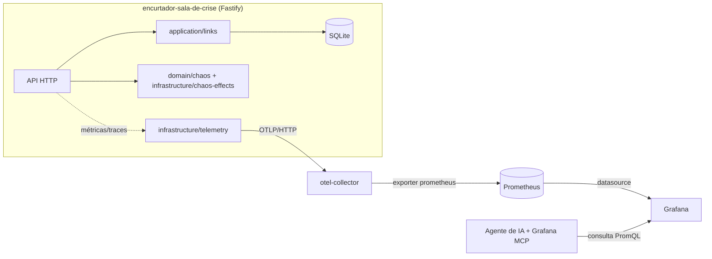

# encurtador-sala-de-crise

Encurtador de URLs instrumentado com OpenTelemetry, acompanhado de uma stack
completa de observabilidade (OpenTelemetry Collector, Prometheus e Grafana) e
de **cenários de falha acionáveis** (`/chaos/*`) com **runbooks-prompt**
prontos para treinar diagnóstico de incidentes com IA. A ideia central é a
"sala de crise": você aciona um problema real e observável no serviço, pede a
um agente de IA com acesso ao Grafana (via MCP) que investigue usando apenas
métricas, e compara o raciocínio do agente com um runbook de referência —
tudo isso rodando localmente, sem depender de nenhum serviço externo pago.

## O que tem no projeto

| Camada / Pasta | Conteúdo | Tecnologias |
| --- | --- | --- |
| `src/domain` | Geração de código base62, validação de URL, política de colisão, registro de cenários de caos | TypeScript puro (sem I/O) |
| `src/application` | Casos de uso de criação/resolução/estatísticas de links, via porta `LinkRepo` | TypeScript |
| `src/infrastructure` | Repositório SQLite, efeitos observáveis do caos (pool fake, buffer, latência, erro), instrumentação OpenTelemetry | `better-sqlite3`, `@opentelemetry/*` |
| `src/api.ts` / `src/server.ts` | API HTTP e entrypoint do servidor | Fastify |
| `observability/` | Stack de observabilidade via Docker Compose | otel-collector, Prometheus, Grafana |
| `runbooks/` | Um prompt de investigação por cenário de caos | Markdown |
| `tests/` | Testes de domínio, aplicação, infraestrutura e API (via `fastify.inject`, sem porta real) | Vitest |
| `.github/workflows/ci.yml` | Pipeline de CI (Node 22: typecheck + testes) | GitHub Actions |

**Stack principal:** TypeScript (`strict`, ESM, Node ≥ 20), Fastify,
`better-sqlite3`, OpenTelemetry (`sdk-node`, métricas + traces via OTLP/HTTP,
com *no-op* gracioso se o collector não estiver de pé), Docker Compose e
Vitest.

## Arquitetura



A aplicação nunca depende da stack de observabilidade para funcionar: se
`OTEL_EXPORTER_OTLP_ENDPOINT` não estiver definido (ou o collector estiver
fora do ar), a instrumentação vira *no-op* automaticamente — zero exceções,
zero crash.

## Como rodar

Pré-requisitos: Node.js ≥ 20 e, opcionalmente, Docker + Docker Compose para a
stack de observabilidade.

```bash
# 1. instalar dependências
npm install

# 2. configurar variáveis de ambiente (opcional para rodar sem observabilidade)
cp .env.example .env

# 3. subir a stack de observabilidade (opcional)
cd observability
docker compose up -d
cd ..

# 4. rodar a aplicação em modo desenvolvimento
npm run dev
# ou, para produção:
npm run build && npm start
```

Com a stack no ar, acesse:

- API: `http://localhost:8080`
- Prometheus: `http://localhost:9090`
- Grafana: `http://localhost:3000` (login anônimo habilitado como Admin, ou
  `admin` / `admin`) — o dashboard **Sala de Crise - Encurtador de URLs** já
  vem provisionado.

### Endpoints da API

| Método | Rota | Descrição |
| --- | --- | --- |
| `POST` | `/links` | Cria um link curto. Body: `{ "url": "https://..." }` → `{ code, shortUrl }` |
| `GET` | `/:code` | Redireciona (302) para a URL original e conta o redirecionamento |
| `GET` | `/stats/:code` | Retorna `{ code, url, createdAt, redirects }` |
| `POST` | `/chaos/:scenario` | Ativa um cenário de caos (`latency-spike`, `error-burst`, `connection-leak`, `memory-leak`) |
| `DELETE` | `/chaos` | Desativa todos os cenários e libera pool/memória vazados |
| `GET` | `/health` | Health check simples |

## Como testar

Toda a suíte de testes roda **100% offline** — nenhum teste depende de
Docker, do otel-collector ou de rede. A aplicação usa repositórios fake
(em memória) e o helper `fastify.inject()` para testar a API sem abrir uma
porta real.

```bash
npm test          # roda a suíte inteira com Vitest
npm run test:watch
npx tsc --noEmit  # checagem de tipos
```

Cobertura por camada:

- **`tests/domain`**: geração de código base62 (RNG injetável), política de
  colisão (3 tentativas ⇒ erro), validação de URL, `ChaosRegistry`
  (enable/disable/reset/estado).
- **`tests/application`**: criação/resolução de link com repositório fake,
  contagem de redirecionamentos, erros de URL inválida e código não
  encontrado.
- **`tests/infrastructure`**: repositório SQLite (`:memory:`), efeitos de
  caos (pool fake, buffer de memória, latência e *error burst* com
  probabilidade injetável), instrumentação OpenTelemetry (SDK mockado, sem
  rede).
- **`tests/api`**: API completa via `fastify.inject`, incluindo o cenário
  `error-burst` com probabilidade forçada em `1.0` (⇒ sempre 500) e a
  contagem de redirecionamentos refletida em `/stats/:code`.

## Variáveis de ambiente

Veja `.env.example`:

| Variável | Descrição | Padrão |
| --- | --- | --- |
| `PORT` | Porta HTTP do servidor | `8080` |
| `PUBLIC_BASE_URL` | Base usada para montar o `shortUrl` retornado por `POST /links` | calculado a partir da requisição |
| `DB_PATH` | Caminho do arquivo SQLite | `./data/links.sqlite` |
| `OTEL_EXPORTER_OTLP_ENDPOINT` | Endpoint OTLP/HTTP do otel-collector. Se ausente, a app roda normalmente sem exportar telemetria | *(vazio)* |
| `OTEL_SERVICE_NAME` | Nome do serviço reportado em traces/métricas | `encurtador-sala-de-crise` |

## Métricas expostas

Todas seguem o padrão `nome{labels}` do Prometheus (nomes fixos, estáveis
entre versões):

| Métrica | Tipo | Labels | Descrição |
| --- | --- | --- | --- |
| `shortener_requests_total` | contador | `route`, `status` | Total de requisições HTTP, por rota (padrão de rota, ex. `/:code`) e status |
| `shortener_request_duration_seconds` | histograma | `route` | Duração das requisições, em segundos |
| `shortener_redirects_total` | contador | `code` | Total de redirecionamentos servidos, por código curto |
| `shortener_errors_total` | contador | `scenario` | Total de erros causados por um cenário de caos ativo |
| `process_memory_rss_bytes` | gauge observável | — | Memória residente (RSS) do processo Node.js |

## O fluxo da "sala de crise"

O objetivo do projeto é treinar (e demonstrar) diagnóstico de incidentes
assistido por IA, usando métricas reais em vez de "chutar" a causa:

1. **Acionar o caos**: escolha um cenário e ative-o, por exemplo:
   ```bash
   curl -X POST http://localhost:8080/chaos/connection-leak
   ```
   Gere tráfego contra `GET /:code` para tornar o efeito visível nas
   métricas e no dashboard do Grafana.

2. **Pedir diagnóstico a um agente de IA com Grafana MCP**: abra o runbook
   correspondente em `runbooks/` (ex. `runbooks/connection-leak.md`) e cole
   o "Prompt para o agente" em uma sessão de IA com acesso ao Grafana via
   MCP (datasource `Prometheus`, dashboard `sala-de-crise`). O agente deve
   investigar usando apenas as queries PromQL disponíveis — sem ver a
   resposta do runbook.

3. **Comparar com o runbook**: cada runbook documenta o sintoma esperado, as
   queries PromQL que confirmam a causa, hipóteses falsas plausíveis para
   descartar, a causa raiz real, a correção (sempre `DELETE /chaos`) e o
   critério de resolução. Compare o raciocínio do agente com esse
   gabarito — divergências são um ótimo material de estudo sobre como IA
   (e humanos) investigam incidentes.

4. **Corrigir**: `DELETE /chaos` sempre reseta tudo — cenários ativos, pool
   de conexões fake e buffer de memória vazado.

## Origem

Inspirado em conceitos do curso de pós Engenharia de Software com IA
Aplicada — implementação própria do zero.

## Licença

[MIT](./LICENSE) © 2026 Vicente Moura
